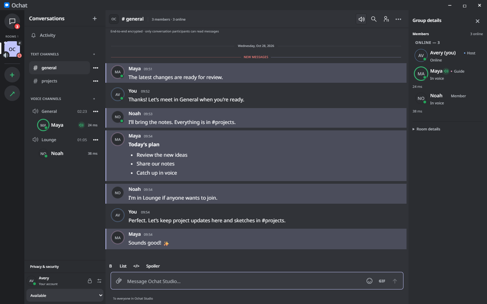
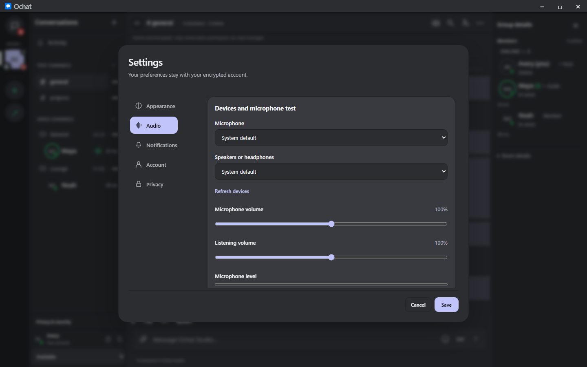
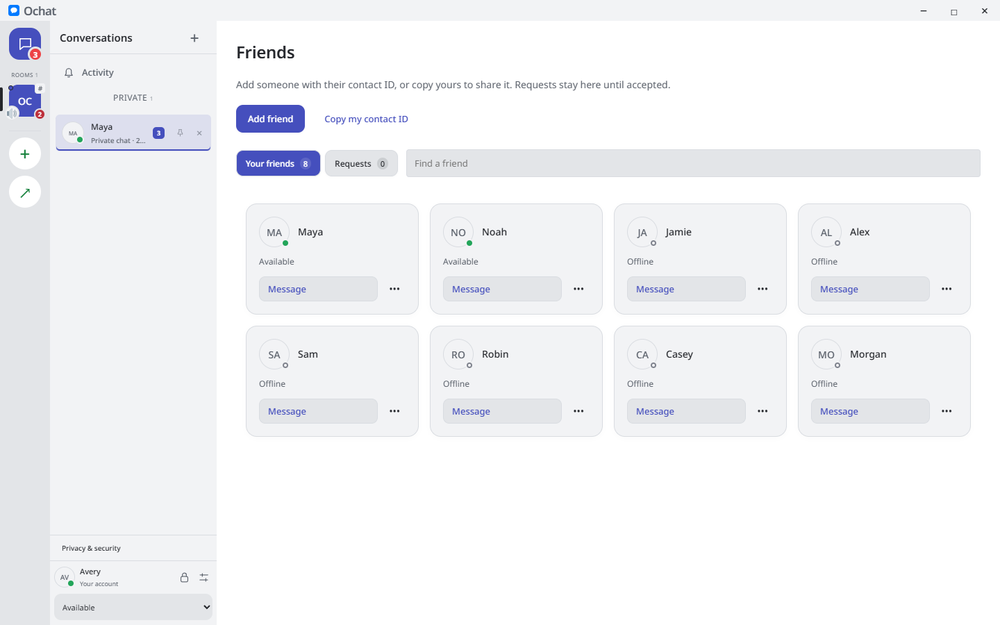

# Ochat

Encrypted peer-to-peer conversations, voice calls and shared spaces for desktop.

## Conversations

- Add friends using contact IDs, manage incoming and sent requests, and start private conversations.
- Organize rooms into text and voice channels, with custom role names, role colors and permissions.
- Control invitations with expiration, usage limits and revocation.
- Reply to messages, create threads, pin useful information, react, edit and delete your messages.
- Write with **bold text**, lists, code blocks and spoilers. Mention members and search conversation history.
- Follow unread counts, typing indicators and optional read receipts. Configure notifications per room and channel.
- Queue messages locally while peers are offline and deliver them when both sides reconnect.

## Voice, video and screen sharing

- Private calls with Accept and Decline, and voice channels you can join voluntarily.
- Microphone and output selection, noise reduction, echo cancellation, automatic gain and a local microphone test.
- Push-to-talk, custom keyboard shortcuts, mute, deafen and individual participant volume.
- Live speaking indicators, call duration and connection diagnostics.
- Webcam and screen/window sharing, quality and frame-rate controls, and resizable detached viewers.
- Choose whether to watch a shared stream. System-audio capture is available on supported platforms.

## Friends and profiles

- Profile photos and animated GIFs, bios with emojis and expandable profile cards.
- Available, Away, Do not disturb and Invisible status, with separate online and voice indicators.
- View peer identity, observed connection route and latency from the profile card.
- Pin and reorder conversations, add local nicknames, and organize chats with folders and colors.
- Open profiles when you choose; startup returns to Home without automatically opening a friend's details.

## Images, files and emojis

- Send files using the file picker or drag and drop, and paste screenshots from the clipboard.
- Accept or decline file offers, see each recipient's decision and resume interrupted downloads.
- Preview images and GIFs, see image thumbnails in replies, and save received images to Favorites.
- Browse Twemoji, recent emojis, your personal custom emojis and a shared room emoji library.
- Search Risibank images and GIFs, send them directly and keep favorites close at hand.
- Crop profile and room illustrations, including support for animated room pictures.

## Personalization

- System, Light and Dark themes, custom accents, background colors, gradients and window transparency.
- Responsive navigation, compact message menus and a persistent voice dock.
- Independent message, file, ringtone and voice-channel sounds, with volume controls.
- Optional notification previews and per-conversation notification preferences.

## Privacy and account control

- End-to-end encrypted peer communications, with direct connections when available and encrypted relay transport when needed.
- Optional Tor routing, relay-only connections and a privacy dashboard showing active connection information.
- A password-protected local account, encrypted history and settings, and an explicit Lock action.
- Encrypted backups and a private recovery key for manual migration to another device.
- Explicit contact blocking, invitation controls and identity verification tools.

*Screenshots show the application with demonstration profiles and conversations.*
